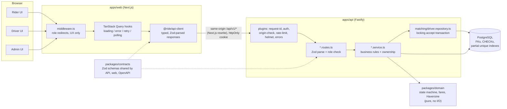

# Architecture questions

Short, direct answers to the eight questions in the assessment brief. Each answer links to the
longer write-up in [`architecture.md`](./architecture.md) where the full reasoning lives.

## System diagram



The browser only ever talks to the web origin; Next.js rewrites `/api/*` to the API. That keeps the
session cookie first-party and removes the need for CORS.

---

## 1. Why did you choose your technology stack and architecture?

**One language, one schema, end to end.** TypeScript on both sides lets a single Zod schema in
`packages/contracts` do four jobs: validate the API request, type the response, generate the
OpenAPI document at `/docs`, and type the web client. A contract change breaks the build
everywhere at once instead of drifting silently.

| Choice                            | Why                                                                                                                                                                                               | Rejected alternative                                                                                   |
| --------------------------------- | ------------------------------------------------------------------------------------------------------------------------------------------------------------------------------------------------- | ------------------------------------------------------------------------------------------------------ |
| **Fastify 5 + type-provider-zod** | Schema-first validation and OpenAPI generation built in; plugin encapsulation for auth/CSRF/rate-limit; fast and small.                                                                           | NestJS: DI and decorators are overhead for a 6-8 hour scope. Express: no schema layer, more glue code. |
| **PostgreSQL 18**                 | The hard part of this problem is concurrency. Postgres gives real transactions, `SELECT ... FOR UPDATE`, and **partial unique indexes**, which are the backstop for "one active ride per driver". | MongoDB or in-memory: no equivalent of a partial unique index plus row lock in one transaction.        |
| **Drizzle ORM**                   | SQL-first: `.for("update")` is visible in the code, migrations are plain reviewable SQL, no hidden lazy queries.                                                                                  | Prisma: weaker control over row locks and partial indexes for this case.                               |
| **Next.js 16 + React 19**         | Preferred by the brief. One deployable serves rider, driver and admin through route groups. Rewrites keep everything same-origin.                                                                 | Three separate SPAs: three deployments for no benefit.                                                 |
| **TanStack Query**                | Loading, error, retry, cache invalidation and polling (with a stop condition) without hand-rolled state.                                                                                          | Hand-written `useEffect` fetching: re-implements all of the above, worse.                              |
| **Vitest + Testcontainers**       | Concurrency and transaction tests must run against **real Postgres**; a mocked DB can't prove a lock works.                                                                                       | Mocked repositories: would pass even with the lock removed.                                            |

**Architecture: a modular monolith.** One API, one database, with strict layering inside it
(routes → services → Drizzle, pure rules in `packages/domain`). At this scale, separate services
would add network failure modes and distributed-transaction problems without adding correctness.
The module boundaries (`rides`, `matching`, `drivers`, `admin`) are drawn where services would be
split later, so extraction would be a move, not a rewrite.

Full decision record: [`decisions/0001-tech-stack.md`](./decisions/0001-tech-stack.md).

---

## 2. How do you prevent two drivers from accepting the same ride?

Three layers, each one sufficient on its own for correctness:

1. **Row lock.** The accept transaction starts with `SELECT ... FOR UPDATE` on the ride row, so
   concurrent accepts for the same ride queue up one behind the other.
2. **Conditional update.** `UPDATE rides SET status='accepted' WHERE id=$1 AND status='requested'`,
   then the row count is checked. Zero rows means someone else won: `409 RIDE_ALREADY_ACCEPTED`.
3. **Database backstop.** Partial unique indexes on `ride_assignments` (`WHERE ended_at IS NULL`)
   make two active assignments per ride, or per driver, physically impossible even if the service
   code had a bug.

```mermaid
sequenceDiagram
  participant D1 as Driver A
  participant D2 as Driver B
  participant API
  participant PG as Postgres

  D1->>API: POST /rides/42/accept
  D2->>API: POST /rides/42/accept
  API->>PG: BEGIN; SELECT ride 42 FOR UPDATE (A)
  API->>PG: BEGIN; SELECT ride 42 FOR UPDATE (B)
  Note over PG: B blocks: A holds the row lock
  API->>PG: (A) lock driver A, check eligibility,<br/>INSERT assignment, UPDATE ... WHERE status='requested'
  PG-->>API: (A) 1 row updated, COMMIT
  API-->>D1: 200 accepted
  Note over PG: lock released, B now reads status='accepted'
  PG-->>API: (B) ride is not 'requested'
  API-->>D2: 409 RIDE_ALREADY_ACCEPTED
```

Locks are always taken ride first, then driver, so two transactions can never wait on each other
in a cycle (no deadlock). One driver racing for two _different_ rides is caught by the
per-driver unique index and returns `409 DRIVER_BUSY`.

**Evidence:** `apps/api/test/accept.test.ts` fires 20 concurrent accepts at one ride against real
Postgres and asserts exactly one winner, exactly one assignment row, and the correct error code
for all 19 losers. The test was checked by temporarily removing the lock: correctness still held
(the index backstop worked), but the losers got the wrong error code, so the test does detect the
lock. Details in [architecture.md §3](./architecture.md#3-concurrency-and-the-driver-accept-race).

---

## 3. How do you handle retries and duplicate requests?

**Creating a ride** (`POST /rides`) requires an `Idempotency-Key` header. The server stores the key
and a SHA-256 hash of the normalised body on the ride row, protected by a unique index on
`(rider_id, idempotency_key)`.

| Same key? | Same body? | Response                                                         |
| --------- | ---------- | ---------------------------------------------------------------- |
| yes       | yes        | `200` with the **original** ride (no second ride is created)     |
| yes       | no         | `409 IDEMPOTENCY_KEY_REUSED`                                     |
| no        | -          | `409 ACTIVE_RIDE_EXISTS` if the rider already has an active ride |

Two simultaneous identical requests both pass the check before either commits. The loser hits the
unique index, and the server then re-reads with a fresh query (the failed transaction is aborted)
and returns the winner's ride, exactly as if it were a normal retry.

**On the client**, `useIdempotencyKey` generates one key per logical booking. Clicking "Retry"
after a timeout reuses the same key; only editing the form starts a new key. A dropped response
followed by a retry therefore never creates a second ride.

**Accept, cancel and complete** are idempotent through the state machine: a repeated call finds the
ride already past that state and gets a `409`, never a double effect.

**Extra protection:** the partial unique index `uq_rides_active_per_rider` allows only one
`requested`/`accepted` ride per rider; the rate limit is 300 requests/min globally, tighter on
login and ride mutations.

**Evidence:** `apps/api/test/rides.test.ts` covers sequential retries _and_ three concurrent races
(same key and body, same key with different bodies, different keys). Two real bugs were found and
fixed by those concurrent tests. See [architecture.md §4](./architecture.md#4-idempotency-and-retry-safety).

---

## 4. How does the frontend respond when an API request fails?

1. **One error shape.** Every API error is the same envelope
   (`{ error: { code, message, details, requestId } }`). `@ride/api-client` turns any non-2xx
   response into an `ApiClientError` with `status`, `code`, `message` and `details`, so components
   never parse raw responses. Successful responses are also Zod-parsed, so a contract mismatch
   fails loudly instead of rendering `undefined`.
2. **Every data view has four states.** Loading shows a skeleton, empty shows a clear message,
   error shows the message with a **Retry** button, and success shows the data. This is a project
   rule (`.claude/rules/frontend.md`) and is covered by component tests.
3. **Mutations can't double-submit.** Buttons disable and change label while pending
   ("Cancelling..."). Errors appear inline with the server's message. Retrying a ride request
   reuses the same idempotency key.
4. **Lost races resolve immediately.** When a driver's accept fails (for example
   `409 RIDE_ALREADY_ACCEPTED`), the UI shows the server's message in an alert and refetches the
   available-rides list right away, so the ride that is gone disappears without waiting for the
   next poll. A rider's cancel that loses to the driver's complete works the same way: the message
   is shown and the ride's real status is refetched.
5. **Polling tolerates blips.** Ride status polls every 4 seconds and stops at a final status.
   Queries retry three times with backoff before showing an error. Once a ride has loaded, a failed
   poll keeps the last known status on screen alongside a Retry button.
6. **Sessions.** `middleware.ts` redirects to `/login` when there's no valid session cookie on
   navigation. This is for UX only; the API re-checks auth and ownership on every request.

**Known gap:** an in-page `401` (token expired mid-session) shows the error state rather than
sending the user to `/login` automatically. A global `401` handler in the query client is listed
under improvements (Q8).

---

## 5. How would you scale the system to multiple cities and thousands of concurrent users?

**Multiple cities already work through data, not code.** `cities` (with service-area bounds),
per-city `ride_packages` (rate cards), and `city_id` on drivers and rides mean a new city is new
seed rows. Fares, eligibility and matching are all already scoped by city.

**For thousands of concurrent users, in order of when each step becomes necessary:**

1. **Scale the API horizontally.** The API is stateless and every concurrency guarantee lives in
   Postgres, not in process memory, so N replicas behind a load balancer need no logic changes.
   Add PgBouncer (transaction pooling) so N replicas don't exhaust Postgres connections.
2. **Replace polling with push.** 5,000 open ride screens polling every 4 seconds is about
   1,250 requests/second of mostly unchanged reads. Server-Sent Events or WebSockets, with status
   changes fanned out through Redis pub/sub, cuts that to one connection per user plus actual
   events.
3. **Index for the hot queries.** Add a composite partial index for the driver's "available rides"
   query, e.g. `(city_id, category, requested_at) WHERE status = 'requested'`. Today only
   `idx_rides_status` exists. Confirm with `EXPLAIN ANALYZE` under realistic data.
4. **Real geospatial matching.** Drivers send their location every few seconds, stored in Redis GEO
   (or PostGIS with a GiST index), so "eligible drivers within 3 km" is an index lookup instead of
   a scan with Haversine. Expand the radius in rings if nobody is found.
5. **Read replicas** for ride history, admin lists and dashboards. Create, accept, cancel and
   complete stay on the primary, because they need the lock.
6. **Partition or shard by city** once one database is no longer enough. Rides never cross cities,
   so `city_id` is a natural partition key. One caveat to design for: Postgres requires the
   partition key in every unique index, so "one active ride per rider" would need a different
   enforcement mechanism (for example, a small `rider_active_ride` table keyed by rider).

---

## 6. When would you introduce Redis, a message broker, or separate services?

Only when a measured need appears. The rule I'd keep: **correctness stays in Postgres** (the accept
lock, idempotency and the unique indexes stay there regardless). New infrastructure is for speed,
fan-out and async work, never for the core invariants.

**Redis**, when any of these happens:

- **More than one API replica.** The rate limiter currently keeps counters in memory per process.
  With 3 replicas, a 5/min login limit is effectively 15/min. A shared Redis store fixes that.
- **Live driver locations.** Updates every few seconds are hot, short-lived data. Redis GEO
  (`GEOSEARCH`) handles them better than writing every update through Postgres.
- **Push notifications across replicas.** Pub/sub, so the replica holding a rider's WebSocket hears
  about an accept that happened on another replica.
- **Caching** of read-mostly data (rate cards, places) once it shows up in profiles.

**A message broker**, when work must happen _later_ and _reliably_: offering a ride to the nearest
driver with a 15-second timeout and fallback, expiring stale requests, sending SMS/push, payment
capture, analytics events. I'd use the **outbox pattern**: write the event row in the same
transaction as the state change, and have a relay publish it. That avoids the dual-write problem
("DB committed, message lost"). I'd start with a Postgres-backed queue (`FOR UPDATE SKIP LOCKED`,
or pg-boss) and move to RabbitMQ, SQS or Kafka only when throughput or fan-out requires it.

**Separate services**, when a part has a different scaling profile, failure tolerance or owning
team. Likely first candidates:

- **Location ingestion:** very high write volume.
- **Dispatch/matching:** CPU-heavy, needs its own deploy cadence.
- **Payments:** a separate compliance (PCI) boundary.
- **Notifications:** third-party failures shouldn't affect booking.

Not before then: one deployable is cheaper to run, debug and keep consistent.

---

## 7. How would you deploy the application, monitor it, and roll back a faulty release?

**Deploy.**

- **CI on every PR:** lint, typecheck, unit tests, and integration tests against a real Postgres
  (Testcontainers), plus Playwright end-to-end tests against the composed stack.
- **On merge:** build the API and web images (multi-stage, non-root, already in the repo), tag
  them with the git SHA, and push them to a registry.
- **Migrations run first,** as a separate one-off job. The images deliberately don't migrate on
  start, so N replicas never race to run them. Migrations are always additive (expand, then
  contract later), so the _old_ code still works against the _new_ schema.
- **Rolling deploy** to a container platform (ECS, Cloud Run, Fly or Kubernetes) with managed
  Postgres (automated backups, point-in-time recovery). New instances receive traffic only after
  `GET /api/v1/health/ready` (which checks the database) passes.

**Monitor.**

- **Logs:** pino JSON, already with a `requestId` on every line that matches the `x-request-id`
  response header and the `requestId` in error bodies. Ship them to a log aggregator. Secrets are
  redacted (authorization header, cookies, passwords, tokens).
- **Metrics:**
  - Per-route request rate, error rate and latency (p50/p95/p99).
  - Database pool saturation.
  - Business signals: rides requested per minute, time-to-accept, the `409 RIDE_ALREADY_ACCEPTED`
    rate, cancellation ratio, and **rides stuck in `requested` for more than N minutes**.
- **Traces:** OpenTelemetry across web, API and database to find slow requests.
- **Alerts:** 5xx rate, p95 latency, readiness failures, and stuck rides. Error tracking (e.g.
  Sentry) on both API and web.

**Roll back.** Redeploy the previous image tag. Because migrations are additive, no down-migration
is needed, which removes the most common rollback failure (code and schema rolled back out of
order). Risky features ship behind a flag so they can be switched off without a deploy. A database
restore from point-in-time recovery is the last resort, used only for data corruption, never for a
bad code release.

---

## 8. What are the three most important improvements you would make before production?

1. **Ride expiry and real dispatch.** Today a `requested` ride nobody accepts stays `requested`
   forever. Because only one active ride per rider is allowed, that rider is **blocked from booking
   again** until they cancel by hand. A scheduled job that expires stale requests (the `expired`
   transition already exists and is tested) is the minimum. The next step is pushing offers to the
   nearest eligible drivers with a timeout and fallback, instead of drivers pulling from a list.
2. **Observability and alerting.** Metrics, tracing, error tracking and the alerts listed in Q7.
   Without them there's no way to know in production whether accepts are slow, failing, or leaving
   rides stuck. This matters more than any new feature.
3. **Session and abuse hardening.**
   - Refresh-token rotation with server-side revocation (a 15-minute JWT can't be revoked today).
   - A global `401` handler in the web app.
   - A Redis-backed rate-limit store once there is more than one replica.
   - MFA for admin accounts.
   - An audit log of admin actions (driver enable/disable, price changes).

Next in line: push instead of polling, real geocoding and routing instead of seeded places and
Haversine × 1.3, a CI pipeline, a load test of the accept path, and resolving the two moderate
transitive dependency advisories noted in `PROGRESS.md`.
